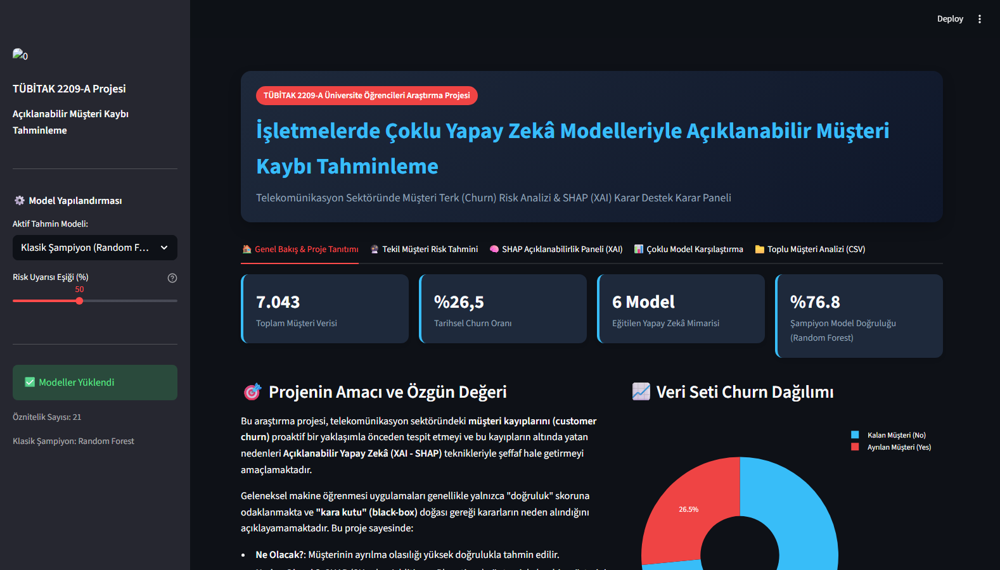
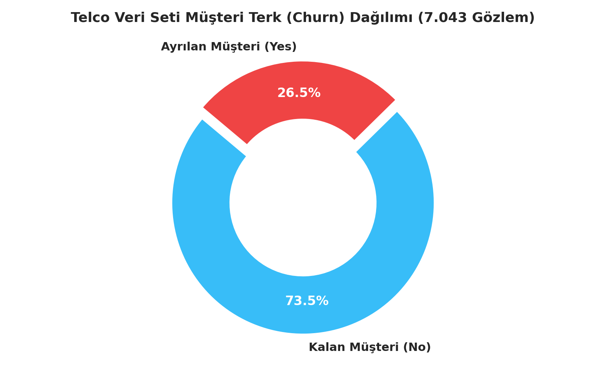
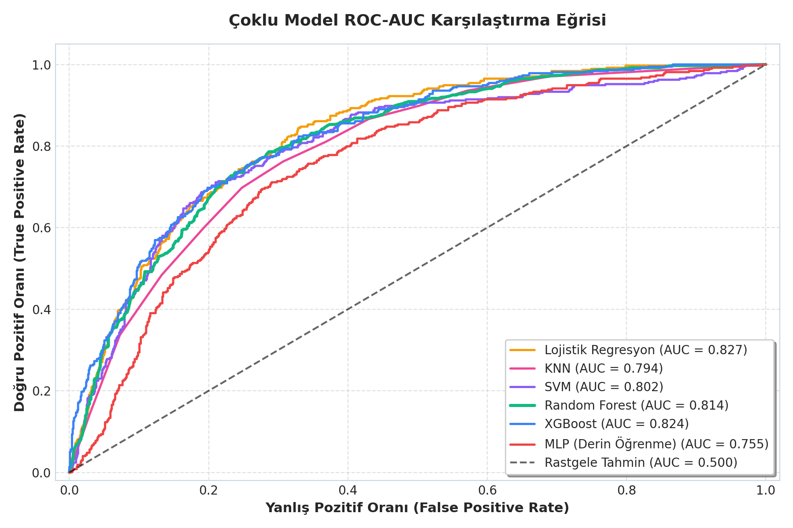
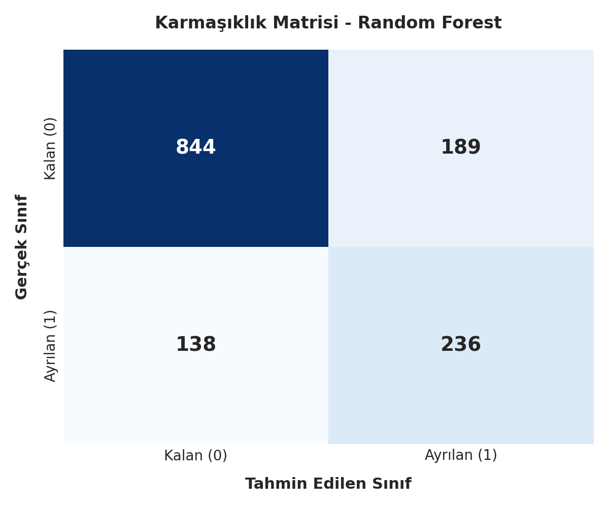
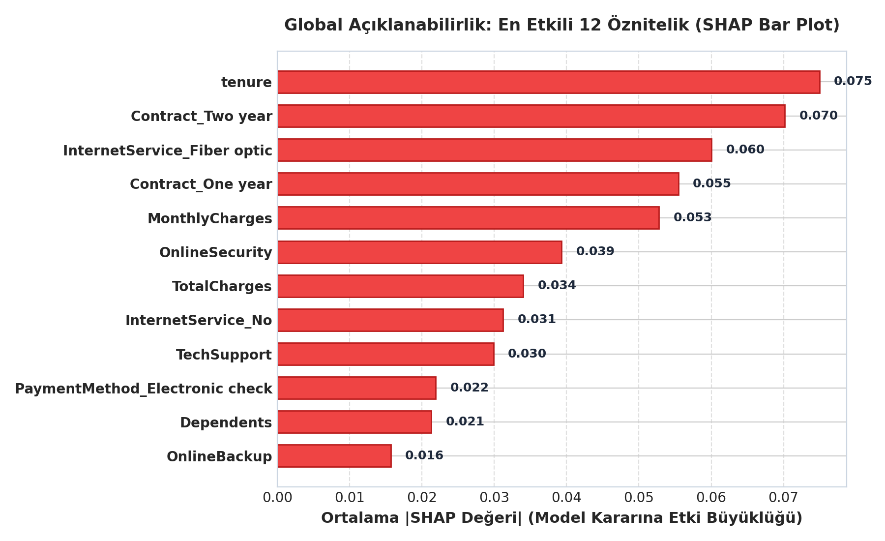
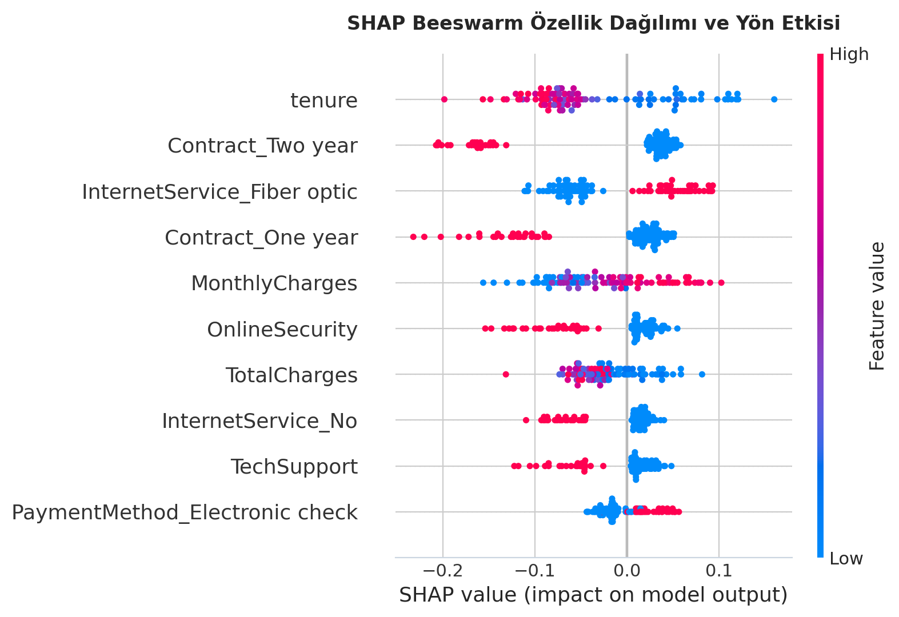
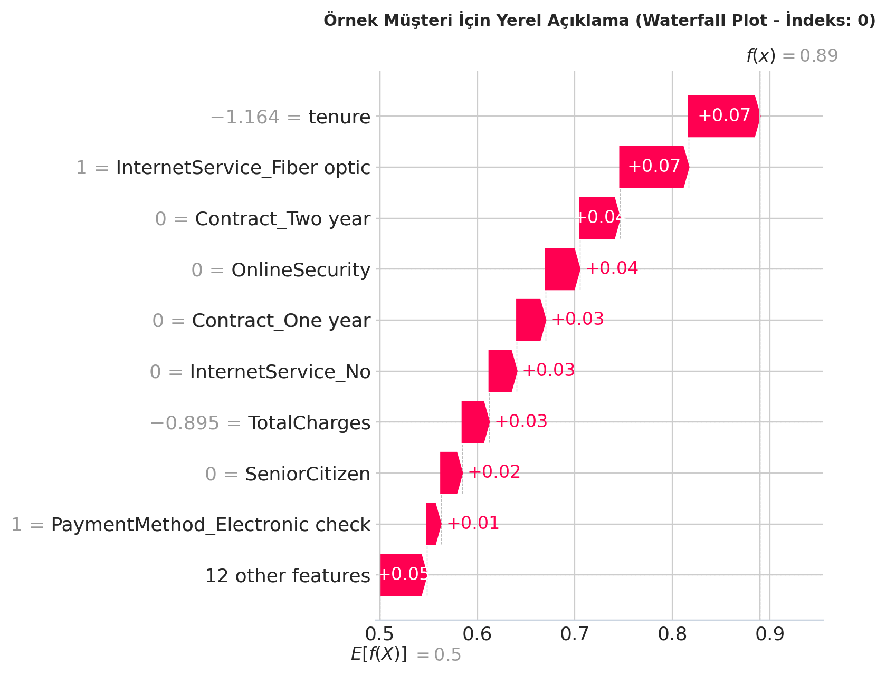

# 🧠 Açıklanabilir Çoklu Yapay Zekâ Modelleriyle Müşteri Terk (Churn) Analizi & Karar Destek Paneli

<div align="center">

[](https://tubitak.gov.tr/)
[](https://python.org)
[](https://streamlit.io)
[](https://shap.readthedocs.io/)
[](LICENSE)

<br/>

**Telekomünikasyon Sektöründe Çoklu Makine Öğrenmesi / Derin Öğrenme Mimarileri, SHAP Yorumlanabilirlik Analizleri ve İnteraktif Karar Destek Arayüzü**

</div>

---

## 📌 Proje Genel Görünümü



Geleneksel makine öğrenmesi uygulamaları genellikle yalnızca "doğruluk" skoruna odaklanmakta ve **"kara kutu" (black-box)** doğası gereği kararların gerekçesini iş birimlerine açıklayamamaktadır. 

Bu araştırma projesi, telekomünikasyon sektöründeki **müşteri kayıplarını (customer churn)** proaktif bir yaklaşımla önceden tespit etmeyi ve bu kayıpların altında yatan nedenleri **Açıklanabilir Yapay Zekâ (XAI - SHAP)** teknikleriyle şeffaf hale getirmeyi amaçlamaktadır. Proje kapsamında 6 farklı yapay zekâ mimarisi eğitilmiş, kapsamlı metriklerle kıyaslanmış ve karar vericilerin anlık aksiyon alabilmesi için uçtan uca interaktif bir **Streamlit** karar destek paneli geliştirilmiştir.

---

## 👥 Proje Ekibi ve Danışman

Bu çalışma, **TÜBİTAK 2209-A Üniversite Öğrencileri Araştırma Projeleri Destekleme Programı** kapsamında yürütülmüştür.

| Görev | Ad Soyad |
| :--- | :--- |
| **Akademik Danışman** | **Yeşim Ülgen Sönmez** (Danışman Hoca) |
| **Araştırmacı / Geliştirici** | **Ahmet Gün** |
| **Araştırmacı / Geliştirici** | **Gülsüm Çelik** |
| **Araştırmacı / Geliştirici** | **Sefa Şahin** |
| **Araştırmacı / Geliştirici** | **Yusuf Alataş** |

---

## 📊 Veri Seti ve Ön İşleme

Projede **Telco Customer Churn** veri seti kullanılmıştır. Veri seti, müşterilerin demografik bilgilerini, kullandıkları hizmetleri ve hesap/sözleşme dinamiklerini içermektedir.

* **Toplam Gözlem:** 7.043 müşteri
* **Hedef Değişken (`Churn`):** 
  * Kalan Müşteri (`No`): 5.174 (%73,5)
  * Ayrılan Müşteri (`Yes`): 1.869 (%26,5)
* **Öznitelik Sayısı:** 21 (İşlenmiş ve kodlanmış)



### Uygulanan Veri Hazırlık Adımları:
1. **Veri Temizleme:** Eksik ve tutarsız değerlerin tespiti (`TotalCharges` sütunundaki boşlukların sayısal formata çevrilmesi ve medyan ile doldurulması).
2. **Kategorik Kodlama:** İkili değişkenler için `Label Encoding`, çok sınıflı değişkenler için (Sözleşme tipi, İnternet servisi, Ödeme yöntemi vb.) `One-Hot Encoding`.
3. **Öznitelik Ölçeklendirme:** Sayısal sürekli değişkenler (`tenure`, `MonthlyCharges`, `TotalCharges`) `StandardScaler` ile normalize edilmiştir.
4. **Sınıf Dengesizliği Çözümü:** Churn sınıfındaki dengesizlik (1:3 oranı), eğitim seti üzerinde **SMOTE (Synthetic Minority Over-sampling Technique)** ile dengelenerek modellerin azınlık sınıfı kaçırması engellenmiştir.

---

## 🤖 Eğitilen Yapay Zekâ Modelleri ve Başarım Karşılaştırması

Projede hem klasik makine öğrenmesi hem de derin öğrenme (yapay sinir ağları) mimarileri olmak üzere toplam **6 farklı model** eğitilmiş ve test kümesi üzerinde kıyaslanmıştır:

1. **Lojistik Regresyon (Logistic Regression)** - Temel referans (baseline) model
2. **K-En Yakın Komşu (KNN)** - Örnek tabanlı öğrenme
3. **Destek Vektör Makineleri (SVM)** - Çekirdek (kernel) tabanlı sınıflandırma
4. **Rastgele Orman (Random Forest)** - Topluluk (Ensemble Bagging) modeli *(Klasik Şampiyon)*
5. **XGBoost (Extreme Gradient Boosting)** - Gradyan artırma (Boosting) modeli
6. **MLP (Multi-Layer Perceptron)** - Çok katmanlı yapay sinir ağı / Derin öğrenme

### 📈 Test Kümesi Başarım Metrikleri

| Sıra | Model | Accuracy (Doğruluk) | Precision (Kesinlik) | Recall (Duyarlılık) | F1-Score | AUC Skoru |
| :---: | :--- | :---: | :---: | :---: | :---: | :---: |
| 🏆 | **Random Forest (Klasik Şampiyon)** | **0.768** | **0.555** | 0.631 | 0.591 | **0.814** |
| 🥈 | **XGBoost** | 0.748 | 0.518 | 0.746 | **0.611** | **0.824** |
| 🥉 | **Lojistik Regresyon** | 0.746 | 0.515 | 0.751 | **0.611** | **0.827** |
| 4 | **SVM (Destek Vektör)** | 0.745 | 0.514 | 0.733 | 0.604 | 0.802 |
| 5 | **KNN (K-Nearest Neighbors)** | 0.711 | 0.473 | **0.762** | 0.584 | 0.794 |
| 6 | **MLP (Derin Öğrenme)** | 0.731 | 0.495 | 0.553 | 0.523 | 0.755 |

> **Analiz Notu:** Müşteri kaybı tahmininde yanlış negatifleri (ayrılacak müşteriyi gözden kaçırma maliyeti) en aza indirmek için **Recall** ve **AUC** metrikleri kritik önem taşımaktadır. Random Forest dengeli genel doğruluğuyla (%76,8) klasik şampiyon seçilirken, XGBoost ve Lojistik Regresyon yüksek AUC (>0.82) skorlarıyla öne çıkmıştır.

---

## 📉 ROC Eğrileri ve Karmaşıklık Matrisleri

Modellerin ayırt edicilik gücünü ve sınıflandırma başarılarını doğrulamak için ROC-AUC analizleri ve karmaşıklık matrisleri üretilmiştir:

| ROC-AUC Karşılaştırma Eğrisi | Karmaşıklık Matrisi (Confusion Matrix) |
| :---: | :---: |
|  |  |

---

## 🧠 Açıklanabilir Yapay Zekâ (XAI - SHAP) Modülü

Sistemin en özgün yönü, tahmin kararlarını şeffaf ve denetlenebilir kılan **SHAP (SHapley Additive exPlanations)** entegrasyonudur.

### 1. Küresel Açıklanabilirlik (Global Explainability)
Tüm veri kümesinde Churn riskini en fazla tetikleyen ve engelleyen faktörler analiz edilmiştir:

| Ortalama SHAP Değerleri (Öznitelik Önemi) | SHAP Beeswarm Özet Dağılım Grafiği |
| :---: | :---: |
|  |  |

* **En Belirleyici Faktörler:**
  1. `tenure` (Abonelik Süresi): Süre uzadıkça terk riski hızla azalmaktadır.
  2. `Contract_Month-to-month` (Aylık Sözleşme): Churn riskini en çok artıran sözleşme tipidir.
  3. `InternetService_Fiber optic`: Fiber optik abonelerinde yüksek fatura veya servis memnuniyetsizliği kaynaklı terk eğilimi yüksektir.
  4. `MonthlyCharges` (Aylık Fatura Tutarı): Yüksek fatura terk olasılığını doğrudan artırmaktadır.
  5. `TechSupport_No` & `OnlineSecurity_No`: Ek destek hizmeti almayan müşterilerin risk skoru kayda değer derecede yüksektir.

### 2. Yerel Açıklanabilirlik (Local Explainability - Tekil Müşteri Şelale Grafiği)
Sistem, seçilen tek bir müşteri için risk skorunu oluşturan faktörleri pozitif (+) ve negatif (-) katkılarıyla görselleştirir:



---

## 💻 Streamlit Karar Destek Arayüzü Özellikleri

Geliştirilen karar destek sistemi (`app.py`), iş birimleri ve müşteri ilişkileri yöneticileri için 5 ana sekmeden oluşmaktadır:

1. **🏠 Genel Bakış & Proje Tanıtımı:** Proje hedefleri, KPI metrik kartları ve veri seti dağılımları.
2. **🔮 Tekil Müşteri Risk Tahmini:** Müşteri bilgilerinin form üzerinden girilmesiyle anlık Churn skoru göstergesi (Gauge Chart) ve kural tabanlı **otomatik elde tutma önerileri** (Retention Strategies).
3. **🧠 SHAP Açıklanabilirlik Paneli (XAI):** Genel öznitelik önemi bar grafiği, beeswarm dağılımı ve tekil müşteri şelale (waterfall) analizi.
4. **📊 Çoklu Model Karşılaştırma:** 6 modelin tüm başarım metrikleri, interaktif ROC eğrileri ve dinamik karmaşıklık matrisleri.
5. **📁 Toplu Müşteri Analizi (Batch CSV):** Yüklenen toplu müşteri listesi üzerinden toplu risk skorlama ve sonuçları filtrelenmiş CSV olarak indirme.

---

## ⚙️ Kurulum ve Çalıştırma

Projeyi yerel makinenizde çalıştırmak için aşağıdaki adımları takip edebilirsiniz:

### 1. Repoyu Klonlayın
```bash
git clone https://github.com/Ahmet003-cod/Tubitak_2209A_Karar_destek_sistemi_projesi.git
cd Tubitak_2209A_Karar_destek_sistemi_projesi
```

### 2. Sanal Ortam Oluşturun ve Aktive Edin (Tavsiye Edilir)
```bash
# Windows
python -m venv venv
venv\Scripts\activate

# macOS / Linux
python3 -m venv venv
source venv/bin/activate
```

### 3. Gerekli Paketleri Yükleyin
```bash
pip install -r requirements.txt
```

### 4. Modelleri Eğitin (İsteğe Bağlı)
Kayıtlı modeller `models/` klasöründe hazır olarak bulunmaktadır. Yeniden eğitmek isterseniz:
```bash
python train_models.py
```

### 5. Karar Destek Arayüzünü Başlatın (Yerel)
```bash
streamlit run app.py
```
Komutu çalıştırdıktan sonra tarayıcınızda otomatik olarak `http://localhost:8501` adresi açılacaktır.

---

### 🐳 Docker ile Tek Komutta Çalıştırma (Alternatif)

Projeyi hiçbir bağımlılık yüklemeden Docker konteyneri içinde çalıştırmak için:

```bash
docker compose up --build
```
Konteyner ayağa kalktıktan sonra tarayıcınızdan **`http://localhost:8050`** adresine gidebilirsiniz.

Durdurmak için:
```bash
docker compose down
```

---

## 📁 Proje Dizin Yapısı

```text
├── assets/                               # README ve dokümantasyon görselleri
│   ├── streamlit_dashboard_preview.png   # Arayüz önizlemesi
│   ├── churn_distribution.png            # Churn sınıf dağılımı
│   ├── model_comparison_roc.png          # ROC eğrileri
│   ├── confusion_matrix.png              # Karmaşıklık matrisi
│   ├── shap_feature_importance.png       # SHAP özellik önemi
│   ├── shap_summary_beeswarm.png         # SHAP beeswarm grafiği
│   └── shap_waterfall_sample.png         # SHAP şelale grafiği
├── models/                               # Eğitilmiş model ve metrik pkl dosyaları
│   ├── klasik_sampiyon_model.pkl         # Random Forest şampiyon modeli
│   ├── mlp_model.pkl                     # Yapay Sinir Ağı modeli
│   ├── scaler.pkl                        # StandardScaler nesnesi
│   ├── feature_columns.pkl               # Eğitilen öznitelik isimleri
│   ├── shap_data.pkl                     # SHAP değerleri ve örnek test verisi
│   ├── test_data.pkl                     # Doğrulama test kümesi
│   └── metadata.json                     # Karşılaştırma sonuçları ve ROC verileri
├── app.py                                # Streamlit Web Karar Destek Arayüzü
├── train_models.py                       # Veri ön işleme ve model eğitim boru hattı
├── run_detailed_analysis.py              # Detaylı XAI ve metrik analiz betiği
├── WA_Fn-UseC_-Telco-Customer-Churn.csv  # Ham veri seti
├── Dockerfile                            # Konteyner yapılandırması
├── docker-compose.yml                    # Konteyner orkestrasyonu (Port: 8050)
├── .dockerignore                         # Docker filtreleme kuralları
├── requirements.txt                      # Gerekli Python kütüphaneleri
├── LICENSE                               # MIT Lisans belgesi
└── README.md                             # Proje tanıtım ve dokümantasyon belgesi
```

---

## 📜 Lisans ve Teşekkür

* Bu proje [MIT Lisansı](LICENSE) kapsamında lisanslanmıştır.
* Bu çalışma, **TÜBİTAK 2209-A Üniversite Öğrencileri Araştırma Projeleri Destekleme Programı** kapsamında desteklenmiştir. Katkı ve desteklerinden ötürü TÜBİTAK'a ve proje danışmanımız **Yeşim Ülgen Sönmez**'e teşekkür ederiz.
